<p align="center">
  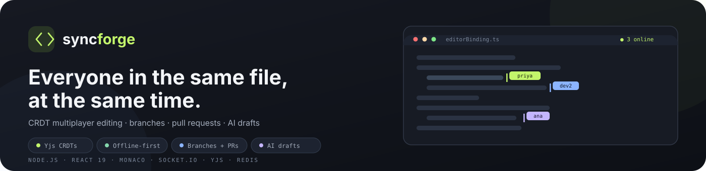
</p>

<p align="center">
  <a href="https://github.com/Priyadharsan-85/SyncForge/actions/workflows/ci.yml"></a>
  <a href="https://github.com/Priyadharsan-85/SyncForge/actions/workflows/docker.yml"></a>
  
  
  
  <a href="LICENSE"></a>
</p>

<p align="center">
  <b>A real-time collaborative code workspace.</b><br />
  Edit the same files together, branch and review like Git, and let AI draft changes you approve — all in the browser.
</p>

<p align="center">
  <a href="#quick-start">Quick start</a> ·
  <a href="docs/DEPLOYMENT.md">Deploy</a> ·
  <a href="#how-it-works">How it works</a> ·
  <a href="docs/API.md">API</a> ·
  <a href="CONTRIBUTING.md">Contributing</a>
</p>

<p align="center">
  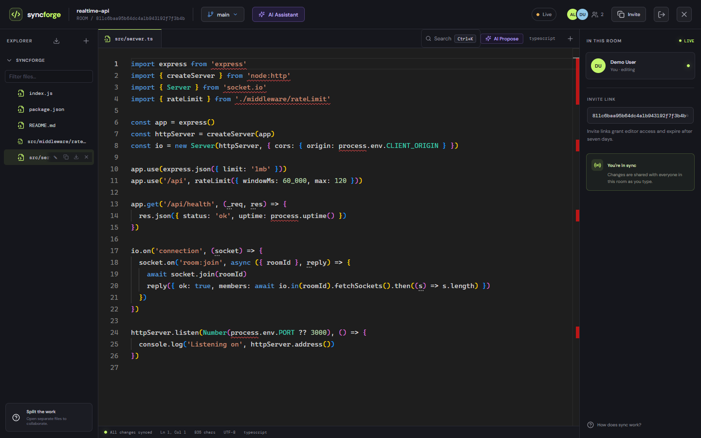
</p>

---

## Features

| | |
|---|---|
| **Real-time collaboration** | Every keystroke reaches everyone in the room through Yjs CRDTs — concurrent edits merge without conflicts or locks. |
| **Offline-first** | Edits are kept in IndexedDB and reconcile automatically when the connection returns. |
| **Branches & commits** | Snapshot the live workspace into commits, branch from any head, and sync a branch back to the live document. |
| **Pull requests** | Open, discuss, diff and three-way merge branches. Conflicts are reported, never silently overwritten. |
| **AI drafts** | Generate JSDoc, refactors, tests or custom changes as *private* draft patches that only land when you accept them. |
| **Import anything** | Start blank, drop in a folder or ZIP, or import a public GitHub repository. |
| **Export anywhere** | Download a workspace as ZIP, or any branch/PR as a `.patch` for `git apply`. |
| **Access control** | GitHub sign-in, owner/editor roles, and seven-day invite links. Knowing a room ID is never enough. |
| **Command palette** | `Ctrl/Cmd+K` to jump to any file or action; keyboard shortcuts for everything else. |
| **Production-ready ops** | Health/readiness probes, Prometheus metrics, build info, structured logs, strict CSP, graceful shutdown. |

<table>
  <tr>
    <td width="50%">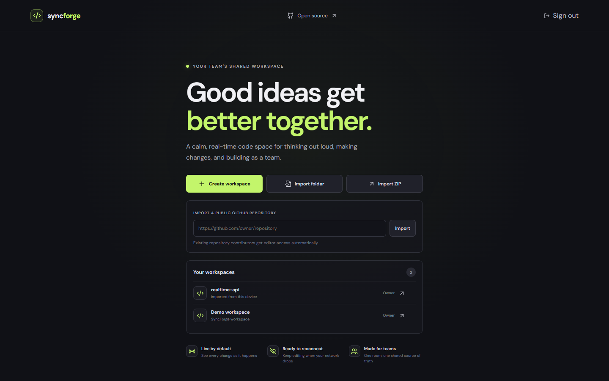</td>
    <td width="50%">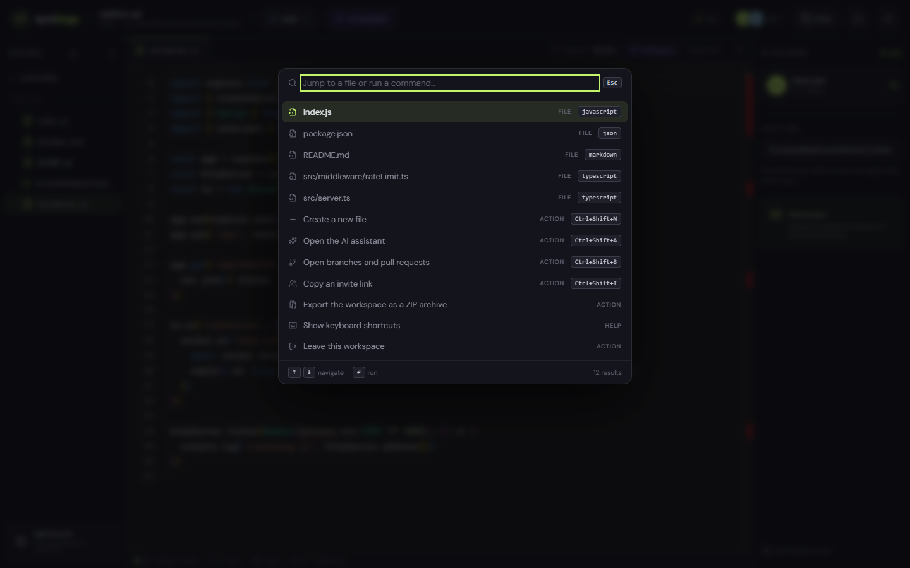</td>
  </tr>
  <tr>
    <td align="center"><sub>Create, import, or reopen a workspace</sub></td>
    <td align="center"><sub>Ctrl/Cmd+K command palette</sub></td>
  </tr>
  <tr>
    <td width="50%">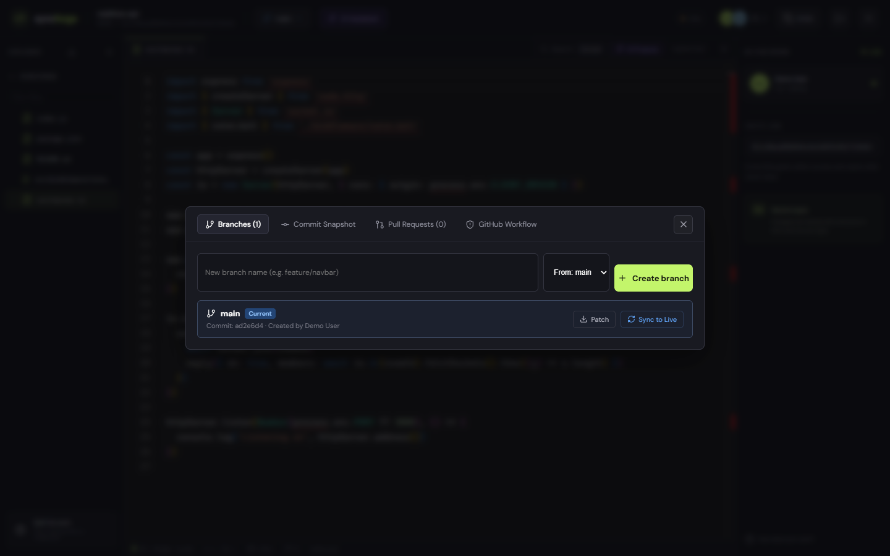</td>
    <td width="50%">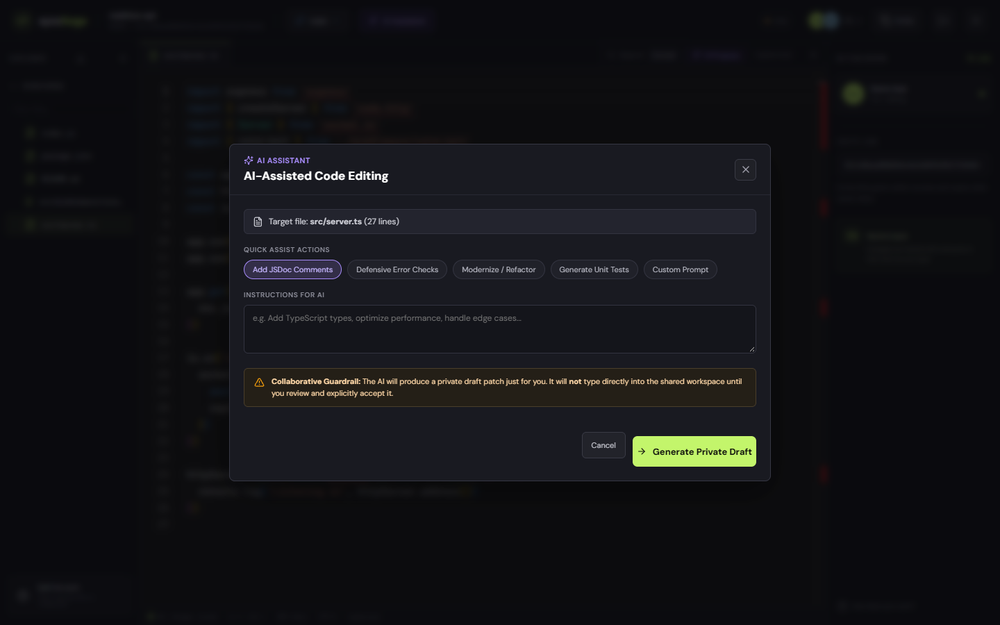</td>
  </tr>
  <tr>
    <td align="center"><sub>Branches, commits and pull requests</sub></td>
    <td align="center"><sub>AI drafts that never touch the shared file until accepted</sub></td>
  </tr>
</table>

---

## Tech stack

| Layer | Technology |
|---|---|
| Client | React 19, TypeScript, Vite, Monaco Editor (bundled, lazy-loaded), Yjs, y-indexeddb, Socket.IO client |
| Server | Node.js 22+, Express 5, Socket.IO 4, Yjs |
| Storage | Redis 7 — document streams, metadata, rate limits, pub/sub (in-memory fallback for development) |
| Auth | GitHub OAuth, HMAC-signed session cookies |
| Delivery | Multi-stage Docker image, Docker Compose + nginx, Render Blueprint, GitHub Actions, GHCR |

---

## How it works

### Architecture

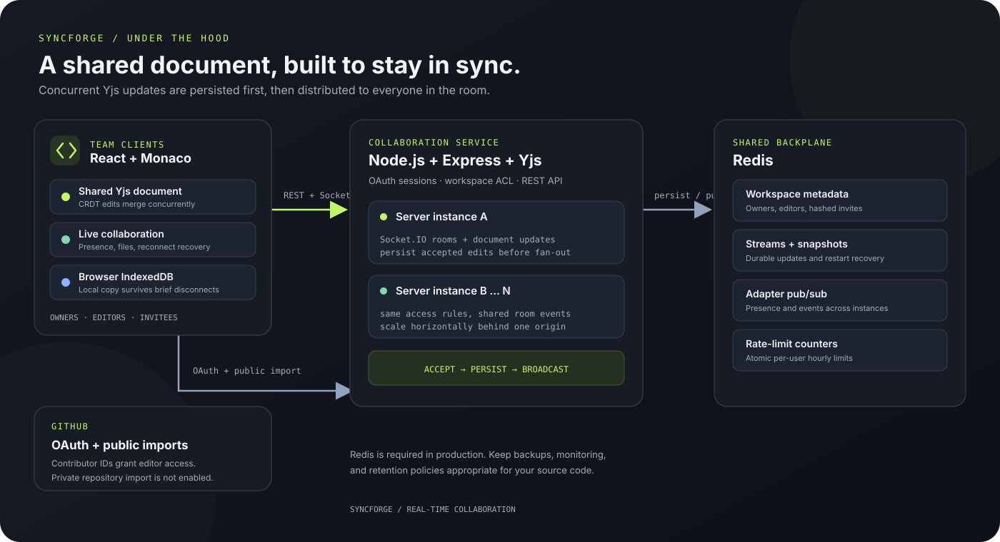

The browser holds a full Yjs replica of the workspace. The server keeps the
authoritative document per room, persists every update to Redis **before**
broadcasting it, and fans updates out to other instances over Redis pub/sub —
so the app scales horizontally behind a load balancer. Without `REDIS_URL` the
server runs entirely in memory for local development.

### One keystroke, end to end

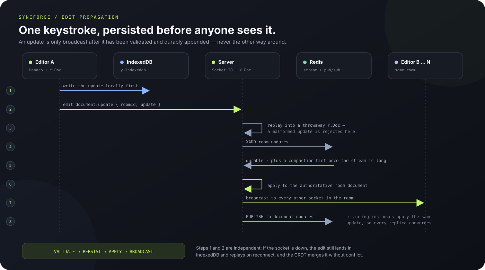

### Branches and pull requests

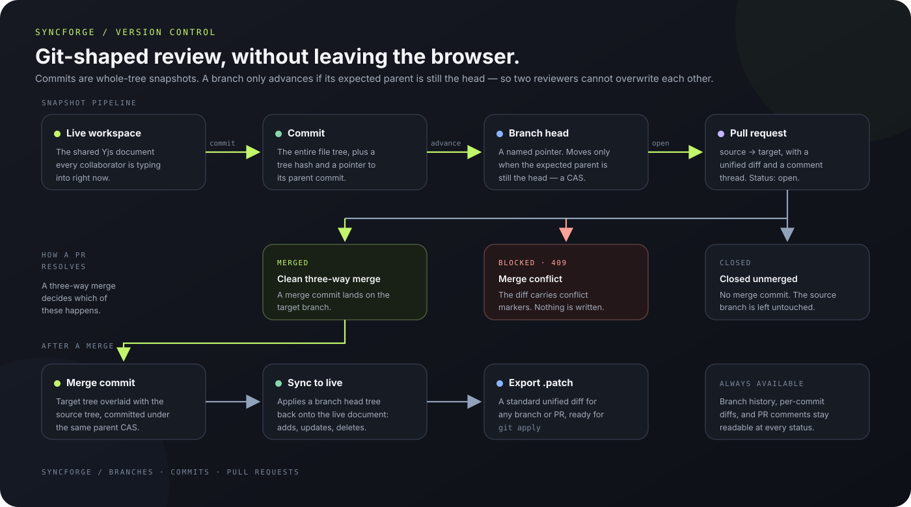

### Access control

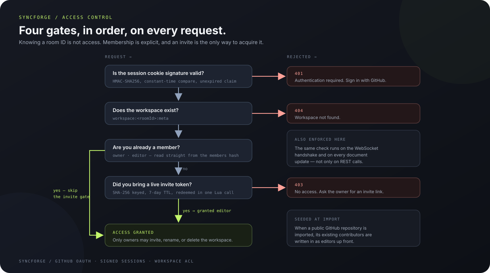

<details>
<summary><b>Redis keyspace</b></summary>

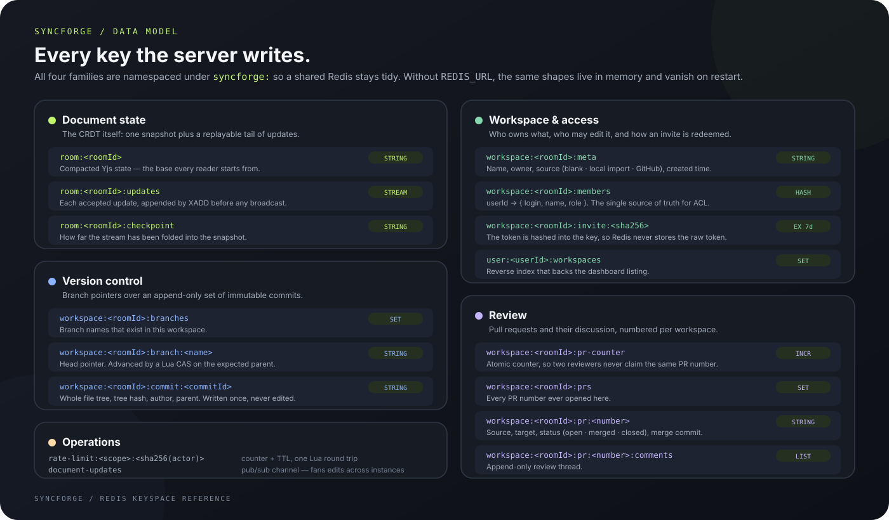

</details>

---

## Quick start

**Prerequisites:** Node.js ≥ 22.18, npm ≥ 10, and optionally Redis 7+ and a
[GitHub OAuth App](https://github.com/settings/developers) for sign-in.

```bash
git clone https://github.com/Priyadharsan-85/SyncForge.git
cd SyncForge
npm install
cp .env.example .env      # fill in SESSION_SECRET and the GitHub OAuth app
npm run dev
```

`npm run dev` starts Vite on <http://localhost:5173> and the API on
<http://localhost:3001>; Vite proxies `/api`, `/auth` and `/socket.io` to the
server, and the server loads `.env` automatically. Set the OAuth App's callback
URL to `http://localhost:5173/auth/github/callback`.

| Command | What it does |
|---|---|
| `npm run dev` | Client and server with hot reload |
| `npm test` | Client and server test suites (`node:test`, 260+ tests) |
| `npm run lint` | oxlint over the client |
| `npm run build` | Type-check and build the client into `client/dist` |
| `npm start` | Run the server; it also serves `client/dist` when present |
| `npm run ci` | Everything CI runs: test, lint, build |

---

## Deployment

[](https://render.com/deploy?repo=https://github.com/Priyadharsan-85/SyncForge)

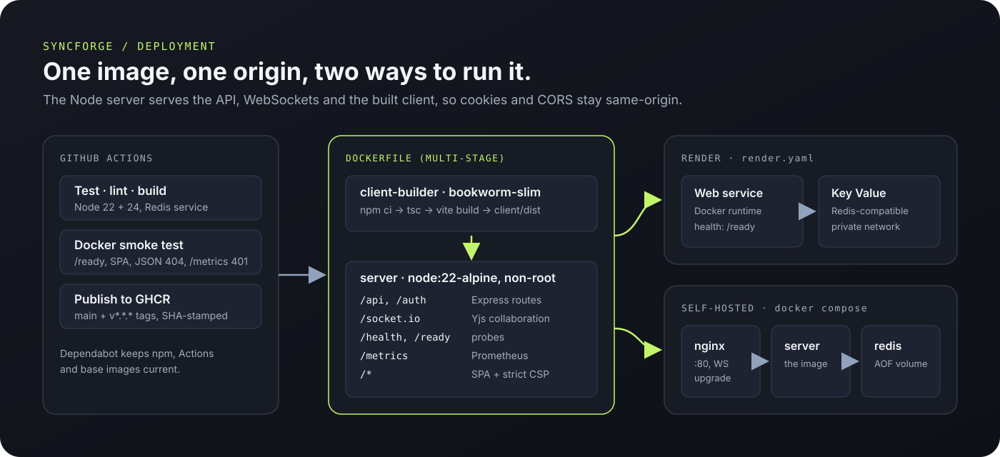

One image serves the API, WebSockets and the client from a single origin.

- **Render** — click the button above; [`render.yaml`](render.yaml) provisions the app and a private Redis.
- **Self-hosted** — `docker compose up -d --build` runs Redis, the app and nginx.
- **Anywhere else** — `ghcr.io/priyadharsan-85/syncforge:main` plus a Redis URL.

The full walkthrough, including the OAuth App setup and troubleshooting, is in
**[docs/DEPLOYMENT.md](docs/DEPLOYMENT.md)**.

### Configuration

| Variable | Required | Default | Description |
|---|---|---|---|
| `CLIENT_ORIGIN` | prod | `RENDER_EXTERNAL_URL` or `http://localhost:5173` | Public URL of the app |
| `SESSION_SECRET` | prod (≥ 32 chars) | — | Signs session cookies |
| `REDIS_URL` | prod | — | Redis connection URL; omit for in-memory dev mode |
| `GITHUB_CLIENT_ID` / `GITHUB_CLIENT_SECRET` | prod | — | GitHub OAuth App credentials |
| `GITHUB_CALLBACK_URL` | no | `<CLIENT_ORIGIN>/auth/github/callback` | OAuth redirect override |
| `PORT` | no | `3001` | Listen port |
| `METRICS_TOKEN` | no | — | Bearer token for `/metrics` in production |
| `REDIS_COMPACTION_THRESHOLD` | no | `500` | Updates per room before snapshot compaction |
| `SERVE_CLIENT` / `CLIENT_DIST_DIR` | no | `true` / `client/dist` | Serve the built client from the server |

Every option is explained in [`.env.example`](.env.example).

---

## Project structure

```
SyncForge/
├── client/                 React + Vite single-page app
│   ├── src/
│   │   ├── App.tsx             workspace shell, sync lifecycle
│   │   ├── CodeEditor.tsx      bundled Monaco + web workers (lazy chunk)
│   │   ├── editorBinding.ts    Yjs ⇄ Monaco binding
│   │   ├── BranchManagerModal.tsx, AiAssistantModal.tsx, CommandPalette.tsx, …
│   └── test/               node:test suites for pure modules
├── server/
│   ├── src/
│   │   ├── index.js            HTTP routes and Socket.IO
│   │   ├── config.js           validated environment config
│   │   ├── staticClient.js     SPA serving with a strict CSP
│   │   ├── redisStore.js       update streams + compaction
│   │   ├── branchManager.js, pullRequestManager.js, semanticMerge.js, diffPatch.js
│   │   ├── workspaceAccess.js, auth.js, rateLimit.js
│   │   └── metrics.js, buildInfo.js, errorHandler.js, requestLogger.js
│   └── test/               unit + integration tests (Redis-backed when available)
├── docs/                   API, deployment guide, diagrams, screenshots
├── Dockerfile              multi-stage production image
├── docker-compose.yml      Redis + app + nginx
└── render.yaml             Render Blueprint
```

---

## Contributing

Issues and pull requests are welcome — see [CONTRIBUTING.md](CONTRIBUTING.md)
and the [changelog](CHANGELOG.md). Please report security issues privately as
described in [SECURITY.md](SECURITY.md).

## License

[MIT](LICENSE) © SyncForge contributors
