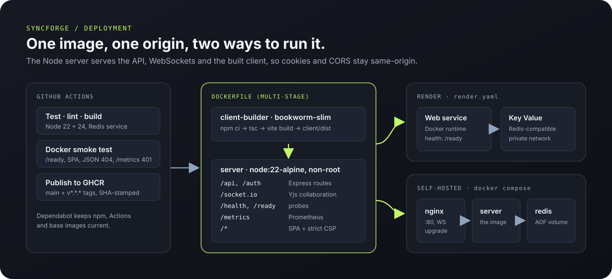

# Deploying SyncForge



SyncForge ships as **one Docker image** that serves the REST API, the
Socket.IO collaboration endpoint and the built React client from a single
origin. Anything that runs a container and offers Redis can host it.

| Requirement | Why |
|---|---|
| Redis 7+ (or a Redis-compatible store) | Durable documents, branches, PRs, sessions-adjacent data and cross-instance pub/sub. Required when `NODE_ENV=production`. |
| A GitHub OAuth App | Sign-in. Callback URL: `<public URL>/auth/github/callback` |
| `SESSION_SECRET` ≥ 32 chars | Signs session cookies |
| WebSocket support on the host | Live collaboration (falls back to long-polling) |

The server refuses to boot in production if any of these are missing, and
prints every problem at once.

---

## Option 1 — Render (one click)

[](https://render.com/deploy?repo=https://github.com/Priyadharsan-85/SyncForge)

[`render.yaml`](../render.yaml) provisions:

- **syncforge** — a Docker web service, health-checked on `/ready`
- **syncforge-redis** — a private Key Value (Redis) instance wired into `REDIS_URL`
- generated `SESSION_SECRET` and `METRICS_TOKEN`

Steps:

1. Click the button and sign in to Render. Approve the Blueprint.
2. Render asks for `GITHUB_CLIENT_ID` and `GITHUB_CLIENT_SECRET`. If you don't
   have an OAuth App yet, enter placeholders and come back after step 3.
3. Once the service has a URL (`https://syncforge-xxxx.onrender.com`), create a
   GitHub OAuth App at <https://github.com/settings/developers>:
   - **Homepage URL**: the service URL
   - **Authorization callback URL**: `<service URL>/auth/github/callback`
4. Put the real client ID and secret in the service's **Environment** tab and
   save — Render redeploys automatically.
5. Open `<service URL>/api/version` and check `commit` matches `main`.

`CLIENT_ORIGIN` defaults to Render's `RENDER_EXTERNAL_URL`. Set it explicitly
when you add a custom domain.

> **Free plan caveats.** The free web service sleeps after ~15 idle minutes
> (the first request then takes ~30–60 s), and free Key Value is not persisted
> across restarts. Use paid plans for anything you need to keep.

---

## Option 2 — Docker Compose (self-hosted)

```bash
cp .env.example .env
# set CLIENT_ORIGIN=http://localhost (or your domain), SESSION_SECRET,
# GITHUB_CLIENT_ID, GITHUB_CLIENT_SECRET
docker compose up -d --build
```

This starts Redis (append-only persistence on a named volume), the app image,
and nginx on port 80 as a WebSocket-aware reverse proxy. Compose stops with a
clear error if a required secret is missing.

For HTTPS, terminate TLS in front of nginx (Caddy, Cloudflare Tunnel, a cloud
load balancer) and set `CLIENT_ORIGIN` to the `https://` URL.

---

## Option 3 — The published image

Every push to `main` and every `v*.*.*` tag publishes
`ghcr.io/priyadharsan-85/syncforge`:

```bash
docker run -d -p 3001:3001 \
  -e REDIS_URL=redis://your-redis:6379 \
  -e CLIENT_ORIGIN=https://syncforge.example.com \
  -e SESSION_SECRET=... \
  -e GITHUB_CLIENT_ID=... -e GITHUB_CLIENT_SECRET=... \
  ghcr.io/priyadharsan-85/syncforge:main
```

This works on Fly.io, Railway, Google Cloud Run (enable session affinity),
Azure Container Apps, ECS or any Kubernetes cluster. Use `/health` as the
liveness probe and `/ready` as the readiness probe.

---

## Scaling out

Run several replicas against the same Redis. The Socket.IO Redis adapter and
the `syncforge:document-updates` channel keep rooms converged across
instances. Enable sticky sessions if the platform supports them so the
long-polling fallback stays on one instance.

## Operations

| Endpoint | Use |
|---|---|
| `/health` | Liveness — stays `200` through Redis blips |
| `/ready` | Readiness — `503` when Redis is unreachable |
| `/api/version` | Which commit is live, uptime, enabled features |
| `/metrics` | Prometheus scrape (`Authorization: Bearer $METRICS_TOKEN`) |

Logs are one JSON object per request with a `reqId` that matches the
`X-Request-Id` response header. On `SIGTERM` the server stops accepting
connections, flushes and closes Redis, and exits within 10 seconds.

## Troubleshooting

| Symptom | Likely cause |
|---|---|
| Boot fails with `Invalid configuration:` | The listed variables are missing or too short |
| Sign-in returns to `?auth=unconfigured` | OAuth credentials or `SESSION_SECRET` not set |
| Sign-in loops or `?auth=failed` | OAuth App callback URL doesn't match `<CLIENT_ORIGIN>/auth/github/callback` |
| GitHub import says the API limit is used up | Set `GITHUB_API_TOKEN` — anonymous calls share a 60/hour limit with every app on the host's IP |
| Editor stuck on "Connecting" | Proxy isn't forwarding WebSocket upgrades on `/socket.io` |
| `403 Invalid request origin` | `CLIENT_ORIGIN` differs from the URL in the browser (scheme, host or port) |
